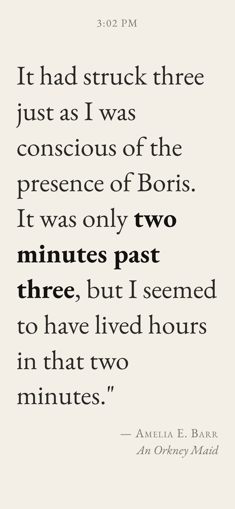
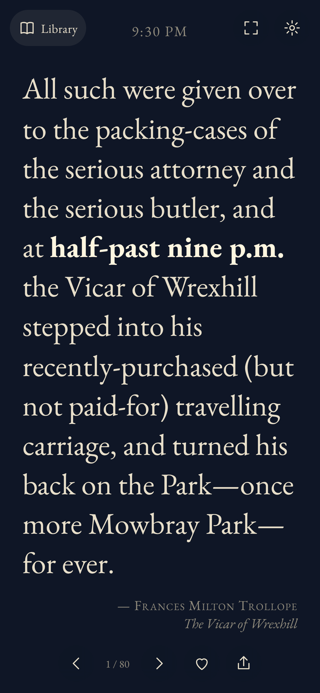
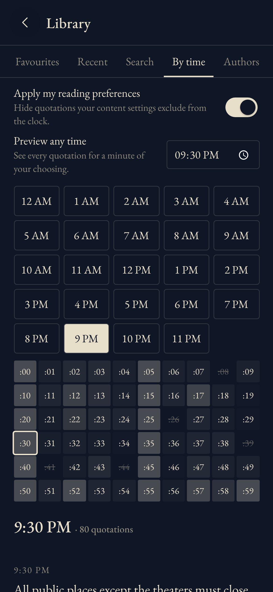
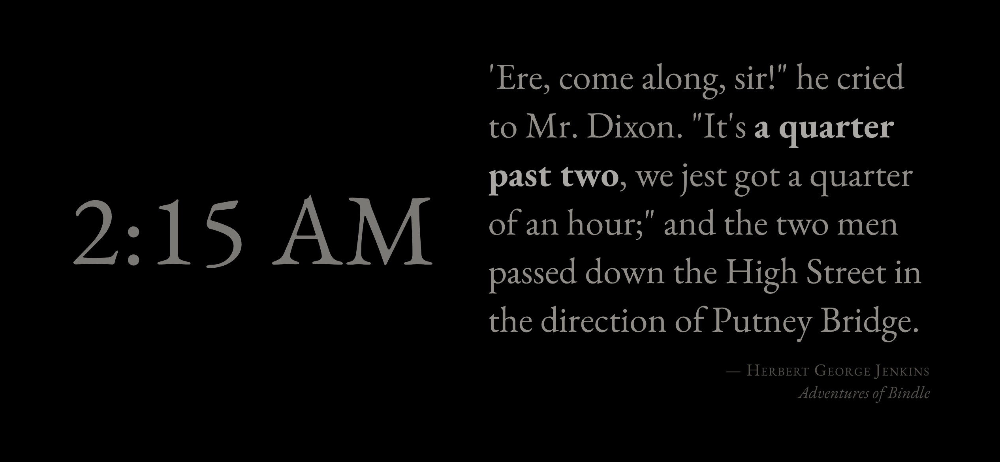

# The Plot Tickens

*The time, told by books.*

A literary clock for your phone, tablet or desk. Each minute it shows a sentence from a public-domain book that mentions that exact time, with the time phrase set in bold and the author and title beneath. It installs as an app, runs fully offline, and has no accounts, tracking or ads.

> It was only **two minutes past three**, but I seemed to have lived hours in that two minutes.

<p align="center">
  
  
  
</p>
<p align="center">
  
</p>

The name is a placeholder. Change it in [`src/config/brand.ts`](src/config/brand.ts) (and run `npm run icons` if you redraw the icon).

## Features

- **A quotation for the minute**, changing exactly on the minute boundary. The clock resynchronises immediately after sleep or backgrounding, and follows timezone and daylight-saving changes.
- **Honest AM/PM.** "Three in the afternoon" appears only at 15:00, while "three o'clock" can appear at 03:00 or 15:00. You can choose to see only explicit times.
- **Never a borrowed quotation.** A minute without a match shows the time in words with a quiet note.
- **No repeats** until every quotation for that minute has been shown, remembered across sessions. Tap the screen to go to the next or previous quotation, favourite it or share it.
- **Typography that fits.** Text is sized to the screen in portrait and landscape, with no clipping or scrolling. There are six bundled OFL serif typefaces plus the system serif.
- **Themes:** Paper, E-Ink, Parchment, Sepia, Midnight, OLED and System, with previews; custom background, text and highlight colours; five highlight styles; alignment, size and weight.
- **Display modes:** Standard, Bedside (big time, dimmed) and Minimal (the quotation only); optional seconds and date; 12- or 24-hour time.
- **Always on:** Screen Wake Lock where supported (requested again whenever the clock becomes visible), theme scheduling by time of day, night dimming below the system minimum, and OLED burn-in shifting.
- **Library:** favourites, recent history, full-text search, browsing by author, work or time of day, previewing any minute, sharing as text or as a locally rendered image, and exporting favourites as Markdown or JSON.
- **Reading preferences:** family-friendly mode and per-category content filters (slurs are hidden by default), plus options for approximate times, translations and quotation length.
- **Private:** settings in localStorage and history and favourites in IndexedDB, all on the device. Preferences can be exported and imported, and everything can be reset.

## Quick start

Requires Node.js 20 or newer.

```bash
npm install
npm run dev            # http://localhost:5173  (service worker disabled in dev)
```

Preview tricks: `http://localhost:5173/?at=16:37` freezes the clock at 4:37 PM, and `&quote=<id>` requests a specific quotation for that minute.

## Test, check, build

```bash
npm run typecheck      # tsc, strict
npm run lint           # eslint
npm test               # vitest: parser, time and DST, rotation, engine, storage, service worker, database integrity
npm run build          # → dist/ (includes manifest, sw.js and the quotation database)
npm run preview        # serve dist/ at http://localhost:4173
npm run test:e2e       # browser checks + screenshots (needs Chrome/Chromium; set CHROME_PATH if not auto-detected)
npm run check          # typecheck + lint + test + build
```

`test:e2e` builds nothing itself, so run `npm run build` first. It checks iPhone, iPad and desktop viewports in both orientations with the shortest and longest quotations (no overflow, highlight present), the controls, theme persistence, library search, the missing-minute fallback, and fully offline reloads. Screenshots go to [`docs/screenshots/`](docs/screenshots).

## Deploy (Cloudflare Pages)

Build command `npm run build`, output directory `dist`. Or deploy from the command line:

```bash
npx wrangler login
npx wrangler pages deploy dist --project-name the-plot-tickens   # or: npm run deploy
```

Full instructions, caching headers and custom domains: [docs/DEPLOYMENT.md](docs/DEPLOYMENT.md).

## Install on iPhone

Open the site in Safari → **Share** → **Add to Home Screen** → **Add**. More detail, including how to use it as a bedside clock and what iOS doesn't allow web apps to do: [docs/IPHONE.md](docs/IPHONE.md).

## The quotation database

Quotations are extracted by this project's own pipeline from public-domain books in **Standard Ebooks** and **Project Gutenberg**, keeping the author, title, year (where known), source link and licence. The well-known literary-clock datasets were researched and deliberately **not** shipped: they are CC BY-NC-SA compilations of excerpts from mostly in-copyright books. See [docs/DATA.md](docs/DATA.md) for the full findings and [docs/coverage-report.md](docs/coverage-report.md) for current coverage.

```bash
npm run data:fetch     # sparse-clone Standard Ebooks repos; download Gutenberg texts (GITenberg mirror) into .corpus/
npm run data:import    # extract candidate quotations → .corpus/*.jsonl
npm run data:legacy    # optional: legacy CSVs, analysed for the report only (clone them into .corpus/legacy/ first)
npm run data:build     # validate, dedupe, rank → public/data/ + docs/coverage-report.md
```

## Documentation

- [Architecture](docs/ARCHITECTURE.md): timing, data format, selection, storage, PWA
- [Data & licensing](docs/DATA.md): sources researched, pipeline, parser, deduplication
- [Coverage report](docs/coverage-report.md)
- [Deployment](docs/DEPLOYMENT.md)
- [iPhone & iPad](docs/IPHONE.md)
- [Future development](docs/FUTURE.md)
- [Third-party notices](THIRD_PARTY_NOTICES.txt)

## Keyboard

Space/→ next quotation · ← previous · F favourite · L library · S settings · Esc hide controls.

## Licence

The quotations are public domain in the US (see [docs/DATA.md](docs/DATA.md)), and fonts and libraries keep their own licences ([THIRD_PARTY_NOTICES.txt](THIRD_PARTY_NOTICES.txt)). No licence has been chosen yet for this repository's own code; add a `LICENSE` file to set one.
